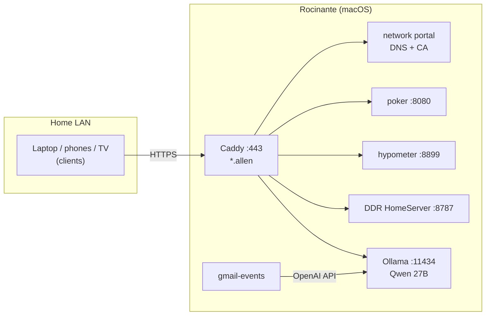

# Rocinante — Home Server

[](LICENSE)
[]()
[]()

> The family's always-on Apple Silicon home server: every `.allen` page, the
> network services, the DDR station, and local Qwen 3.8 27B inference.

**Status:** 🟢 Implementing. The box is bought; scope and success criteria live in
[`docs/objectives.md`](docs/objectives.md).

**Rendered docs:** https://chris-l-allen.github.io/mac-studio-ai-homeserver/

---

## What it does

1. **Every `.allen` page & network service** — DNS for the `allen` zone, a private
   CA with device enrollment, and a Caddy reverse proxy in front of the services
   below.
2. **Local inference** — Qwen 3.8 27B behind an OpenAI-compatible API, used by the
   Gmail→Calendar daemon and any other sensitive job. No cloud calls.
3. **The DDR station** — the HomeDDR song/media library and Project OutFox, folded
   in from the separate `home-ddr` project.

## Services

| Host / unit | Service | Port | Docs |
|---|---|---|---|
| `homenetwork.allen` | portal, DNS, CA, enrollment | `:53`, `:8443`, `:8081` | [network](docs/network.md) |
| `poker.allen` | Moonbeam Hold'em | `:8080` | — |
| `hypometer.allen` | Leafs hypometer | `:8899` | — |
| `ddr.allen` | DDR song/media library | `:8787` | [DDR](docs/ddr.md) |
| `llm.allen` | Ollama / Qwen 27B | `:11434` | [inference](docs/inference.md) |

**Documentation:** [Objectives](docs/objectives.md) · [Migration runbook](docs/migration.md) ·
[Network](docs/network.md) · [Inference](docs/inference.md) · [DDR](docs/ddr.md) ·
[rendered docs](https://chris-l-allen.github.io/mac-studio-ai-homeserver/docs/) ·
[pre-implementation notes](docs/archive/README-pre-implementation.md)

---

## Architecture



## Repository layout

```
.
├── README.md
├── caddy/Caddyfile              # one proxy for every .allen host
├── compose.yaml                 # optional container extras (Caddy runs natively)
├── docs/                        # objectives, migration, network, inference, ddr
│   └── archive/                 # pre-implementation notes
├── launchd/                     # every service; survives reboot
├── scripts/
│   ├── migrate/                 # inventory, package, install, certs
│   ├── pull-models.sh
│   └── serve-ollama.sh
└── services/
    ├── ddr/                     # HomeDDR (code, media, scripts, history)
    └── network/                 # portal/DNS/CA (data/ gitignored)
```

## Model & inference

- **Model:** Qwen 3.8 27B, `Q6_K` (~22 GB) via Ollama — native, not Docker.
- **API:** OpenAI-compatible at `http://llm.allen/v1` and `127.0.0.1:11434/v1`.
- **Gmail:** `com.gmail-events.daemon` runs with `LLM_PROVIDER=ollama`; no API key.
- **Keep-alive:** `OLLAMA_KEEP_ALIVE=-1`, `OLLAMA_CONTEXT_LENGTH=32768`.
- See [inference](docs/inference.md).

## Build / run

```bash
# 1. install the runtime (Apple Silicon)
brew install python3 node caddy ollama

# 2. pull the model
./scripts/pull-models.sh

# 3. install every service
./scripts/migrate/install-services.sh
```

Full move sequence: [docs/migration.md](docs/migration.md).

## Key decisions (kept for the record)

- **Apple Silicon, unified memory.** Inference is bandwidth-bound; one memory pool
  loads a 27B model whole, silently, at low idle power.
- **Qwen 3.8 27B at Q6.** Best quality that fits comfortably; Apache-2.0, 262K
  context.
- **LAN-only + private CA.** No port-forwarding; devices trust the home CA.
- **Native Caddy + launchd.** One reverse proxy; every service auto-starts.
- **Name: Rocinante.** The laptop and other devices are clients; Rocinante serves.
- **DDR folded in.** One box hosts the song library and OutFox.
- **Migration with rollback.** Copy data, verify, then cut over; the laptop stays
  intact until Rocinante passes.
- **No storage/ethernet premium.** Buy the smallest that meets the workload.
- Full deliberation: [pre-implementation notes](docs/archive/README-pre-implementation.md).

## License

MIT — see [LICENSE](LICENSE).
