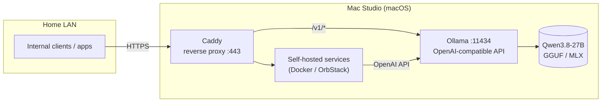

# Mac Studio AI Home Server

[](LICENSE)
[]()
[]()

> A silent, always-on homelab on Apple Silicon that hosts internal web services
> **and** serves a local LLM over an OpenAI-compatible API.

**Status:** 🟡 Hardware selection / pre-build. Nothing here has been assembled yet.

---

## What this is

One box that does two jobs:

1. **Host internal web pages & services** — dashboards, tools, and self-hosted apps,
   published on the LAN through a reverse proxy.
2. **Serve a local LLM** — **Qwen3.8-27B** (Apache-2.0) behind an
   OpenAI-compatible `/v1/chat/completions` endpoint, so internal tools can call it
   like any cloud model — no per-token bill, and no data leaving the house.

Design priorities, in order: **quiet, cheap to run 24/7, enough unified memory for a
27B model, and no ugly tower in the kids' homework space.**

The whole point is the *server* framing: the model is a resident background service
called over HTTP by other apps, not a chat window.

---

## TL;DR

| | |
|---|---|
| **Machine** | Mac Studio (Apple Silicon, unified memory) |
| **Value pick** | **M5 Max · 36 GB · 512 GB — $3,499 CAD** |
| **Max-quality pick** | **Refurb M3 Ultra · 96 GB — ~$5,800 CAD** |
| **Model** | **Qwen3.8-27B** — Apache-2.0, dense, multimodal, 262K context |
| **Serving** | Ollama (native) → OpenAI-compatible API on `:11434` |
| **Services** | Docker (OrbStack) behind Caddy |

**The one open decision:** 27B on the $3,499 M5 Max, or 70B on the ~$5,800 refurb
M3 Ultra. See [Open decisions](#open-decisions--roadmap).

---

## Goals

- [ ] Always-on, silent, low idle power (~10–20 W)
- [ ] Serve **Qwen3.8-27B** at Q6–Q8 with usable context
- [ ] Expose an **OpenAI-compatible API** to internal services
- [ ] Run self-hosted apps in Docker behind a reverse proxy
- [ ] Fit on a desk/shelf without looking like a gaming tower
- [ ] Stay under ~$6,000 CAD

**Non-goals:** model training/fine-tuning, running frontier MoE models (400B+; needs
512 GB), gaming.

---

## Hardware decision

### Why a Mac Studio (and not a GPU tower)

For *serving* an LLM, the binding constraint is **whether the model + KV cache fit in
memory**, and secondarily **memory bandwidth** (which sets tokens/sec). On Apple
Silicon, the CPU, GPU, and Neural Engine share one high-bandwidth memory pool, so a
27B model loads whole — no 24 GB VRAM ceiling.

The GPU-tower route (used RTX 3090 → 24 GB) collapsed in 2026: an AI-driven memory
shortage sent discrete GPU prices through the roof (see
[price snapshot](#pricing-snapshot-oct-2026-cad)). A Mac Studio now delivers more
usable memory per dollar, idles at ~10–20 W, and is silent.

**Big caveat:** macOS is a less natural self-hosting platform than Linux. Docker via
OrbStack/Colima (or a small Linux VM) closes most of the gap; the LLM itself runs
natively because containers on macOS cannot use the Metal GPU.

### The two real options

| | New **M5 Max 36 GB** | Refurb **M3 Ultra 96 GB** |
|---|---|---|
| Price | **$3,499 CAD** *(verified)* | **~$5,800 CAD** (1 TB) *(tracker)* / $8,049 *(4 TB, verified)* |
| Unified memory | 36 GB | **96 GB** |
| Memory bandwidth | ~546 GB/s class *(est.)* | **819 GB/s** *(verified)* |
| CPU / GPU | 18-core / 32-core | 28-core / 60-core |
| What it runs | 27B at Q6/Q8 | 70B at Q4–Q8, or 27B at max context |
| Relative TPS (same model) | baseline | ~1.4× faster |
| Idle power | ~10–20 W | ~10–20 W |
| Warranty | 1 yr (new) | 1 yr (Apple Certified Refurbished) |

> The M3 Ultra's **819 GB/s** is the key number: because the dual-die design has a
> wider memory bus, it serves the *same* model ~1.4× faster than an M4 Max (546 GB/s)
> or an M5 Max — despite being an older generation. LLM serving is memory-bandwidth
> bound, not compute bound.

### Pricing snapshot (Oct 2026, CAD)

Verified figures came from Apple's Canadian store and third-party trackers during
planning. **Prices move — re-check before buying.**

| Configuration | Price (CAD) | Note |
|---|---|---|
| New M5 Max · 36 GB · 512 GB | **$3,499** | Apple CA; also `$158.23/mo × 24` |
| New M5 Max · 36 GB (education) | **$3,219** | Requires UNiDAYS / post-secondary or school staff |
| New M5 Max · 64 GB · ~1 TB | ~$4,000 *(est.)* | Only worth it for future 70B headroom |
| New M5 Ultra · 96 GB · 1 TB | **$7,799** | Overkill for 27B |
| Refurb M3 Ultra · 96 GB · 1 TB | **~$5,800** | Rotating stock; tracker ~$4,329 USD |
| Refurb M3 Ultra · 96 GB · 4 TB | **$8,049** | Verified Apple CA listing — avoid the SSD premium |

**Do not overpay for storage.** Model weights are ~17–70 GB; the 4 TB SSD on the
refurb unit adds thousands of dollars you don't need. Buy 512 GB–1 TB.

### CPU / GPU / memory: what actually matters

- **CPU:** effectively fixed on the M5 Max (18-core in both SKUs). It is *not* the
  LLM bottleneck — 18 cores is already overkill for a home server.
- **GPU:** 32- vs 40-core is the real difference between the two M5 Max SKUs, but it
  barely matters for inference (bandwidth-bound). Small benefit for non-LLM GPU work.
- **Memory *capacity*:** does **not** increase tokens/sec. Bandwidth is fixed per
  chip tier; 36/64/128 GB all run at the same speed. More RAM buys *capacity*:
  bigger KV cache, higher quantization, or larger models. 64 GB does **not** make a
  27B faster than 36 GB.
- **Memory *bandwidth*:** this is the lever for tokens/sec, and it's set by the chip
  tier (Max vs Ultra), not by how much RAM you buy.

### Finance vs cash

Apple CA lists the M5 Max at `$158.23/mo × 24 = $3,797.52`, i.e. **~$298 interest
(~8% APR)** over the $3,499 price. Fine if you want to stay liquid; skip it if you
have cash. **Avoid the Apple Upgrade (Klarna) lease** for a box you intend to keep —
it's a rental, not a purchase.

**Education pricing** is post-secondary only (or school staff). Parents of K-12
students do **not** qualify; as of May 2026 Apple Canada requires **UNiDAYS**
verification and the old honor-system loophole is closed.

---

## Model choice

**Qwen3.8-27B** (`Qwen/Qwen3.8-27B`, Apache-2.0) — verified from the model card:

- 27B dense language model + vision encoder (~28B total), BF16 native
- Native **image + video** understanding
- **262K** native context, extensible to 1M
- **Thinking mode on by default** (disable per request with `enable_thinking: false`)
- Hybrid architecture: Gated DeltaNet (linear attention) + Gated Attention, with MTP
- GGUF / Ollama / MLX builds already exist
  (`unsloth/Qwen3.8-27B-GGUF`, `mlx-community/Qwen3.8-27B-4bit`)

### VRAM / memory footprint

| Quantization | Weight size | Fits on |
|---|---|---|
| BF16 | ~54 GB | 2× GPU, or 96 GB+ unified |
| Q8 | ~28 GB | 32 GB+ / 64 GB+ unified |
| **Q6** | **~21–22 GB** | **36 GB unified ✅ (recommended)** |
| Q4 | ~15–17 GB | 24 GB GPU |

### If you go to 96 GB (M3 Ultra)

You unlock the **70B dense tier**:
- **DeepSeek-R1-Distill-70B** — best local reasoning at this size
- **Llama 3.3 70B** — the safe, well-supported generalist
- Qwen's 2026 *dense* self-host ceiling is still the 27B; its flagship is a 2.4T MoE
  that **will not fit** in 96 GB (that needs a 512 GB config).

---

## Architecture



**Traffic flow**
1. A browser or internal app hits `https://something.internal`.
2. Caddy terminates TLS and reverse-proxies to the matching service.
3. Services that need AI call `http://host.docker.internal:11434/v1/...`.
4. Ollama runs the model resident and returns tokens.

---

## Software stack

| Layer | Choice | Why |
|---|---|---|
| LLM runtime | **Ollama** (native) | One-command models, OpenAI-compatible API, Metal GPU |
| Alt runtime | llama.cpp `server` / MLX-LM | More control / max Apple-Silicon speed |
| Containers | **OrbStack** | Fast, light Docker on macOS |
| Reverse proxy | **Caddy** | Automatic internal TLS, tiny config |
| Remote access | *TBD* — Tailscale likely | No port-forwarding |

> **Important:** run Ollama **natively**, not in Docker. Containers on macOS have no
> Metal/GPU passthrough, so a containerized Ollama would fall back to CPU. Docker is
> for the *other* services only.

---

## Quick start

```bash
# 1. Install runtime (native)
brew install --cask ollama        # or download from ollama.com

# 2. Pull the model (Q6_K ≈ 22 GB)
./scripts/pull-models.sh

# 3. Run the API in the foreground (test)
./scripts/serve-ollama.sh

# 4. In another shell — verify the OpenAI-compatible endpoint
curl -s http://localhost:11434/v1/chat/completions \
  -H 'Content-Type: application/json' \
  -d '{
        "model": "hf.co/unsloth/Qwen3.8-27B-GGUF:Q6_K",
        "messages": [{"role":"user","content":"Reply with the word: ready"}],
        "chat_template_kwargs": {"enable_thinking": false}
      }' | jq .

# 5. Install as a background service (macOS launchd)
cp launchd/com.local.ollama.plist ~/Library/LaunchAgents/
launchctl load ~/Library/LaunchAgents/com.local.ollama.plist

# 6. Bring up the web/services stack
docker compose up -d
```

### Persistence

The launchd plist keeps Ollama running with:
- `OLLAMA_KEEP_ALIVE=-1` — model stays resident (it's a server)
- `OLLAMA_CONTEXT_LENGTH=32768` — tune to your RAM headroom
- `OLLAMA_HOST=0.0.0.0:11434` — reachable from the LAN / containers

Adjust the binary path inside the plist if you installed Ollama via Homebrew
(`/opt/homebrew/bin/ollama`) instead of the app.

---

## API usage

Any OpenAI SDK works by pointing `base_url` at Ollama:

```python
from openai import OpenAI

client = OpenAI(base_url="http://localhost:11434/v1", api_key="not-needed")

resp = client.chat.completions.create(
    model="hf.co/unsloth/Qwen3.8-27B-GGUF:Q6_K",
    messages=[{"role": "user", "content": "Summarize this ticket..."}],
    extra_body={"chat_template_kwargs": {"enable_thinking": False}},
)
print(resp.choices[0].message.content)
```

**Multimodal:** send images as base64 in the OpenAI `image_url` content block. Video
input works but is heavy — treat it as out-of-scope for 24/7 serving.

---

## Repository layout

```
.
├── README.md
├── compose.yaml               # web/services stack (Ollama is NOT here)
├── .env.example
├── caddy/
│   └── Caddyfile              # internal reverse proxy + TLS
├── launchd/
│   └── com.local.ollama.plist # keep Ollama running at login/boot
└── scripts/
    ├── pull-models.sh         # download Qwen3.8-27B
    └── serve-ollama.sh        # foreground dev/test server
```

---

## Procurement notes (Canada)

- **Apple Certified Refurbished** is the safe secondary channel: 1-year warranty,
  AppleCare+ eligible, like-new. It stocks the *previous* generation (M4 Max /
  M3 Ultra) — the M5 is too new.
- **Refurb inventory rotates**; watch `apple.com/ca/shop/refurbished/mac` and buy
  quickly when the right config appears.
- **Avoid marketplace/used** Macs: Apple Silicon RAM is soldered (unupgradeable), and
  used units carry Activation Lock / MDM (enterprise) risk.
- **Skip the 4 TB SSD** config; buy 512 GB–1 TB.

---

## Open decisions / roadmap

- [ ] **27B vs 70B:** M5 Max 36 GB ($3,499) or refurb M3 Ultra 96 GB (~$5,800)?
- [ ] **Storage:** 512 GB vs 1 TB internal
- [ ] **Reverse proxy:** Caddy (chosen) vs Traefik
- [ ] **Remote access:** Tailscale vs WireGuard
- [ ] **Backups:** Time Machine + offsite, or restic to an external disk
- [ ] **Monitoring:** Uptime Kuma (in compose) + macOS power/thermal checks
- [ ] **Model updates:** pin a quant; test upgrades before swapping

---

## Decision log

A record of how the plan got here (kept for future-me):

1. **Started** with "Mac Studio seems expensive; maybe kit-bash a GPU tower."
2. **Verified the model:** Qwen3.8-27B is real — 27B dense multimodal, Apache-2.0,
   262K context (corrected an earlier wrong assumption about Qwen's lineup).
3. **Checked GPU prices:** the 2026 AI-memory shortage sent RTX 4090 to ~$4,399,
   5090 to ~$7,488, and used 3090s to ~$1,100–1,400. The GPU tower lost its
   value advantage.
4. **Settled on Mac Studio** for unified memory, silence, and ~10–20 W idle.
5. **Sized the memory:** 36 GB runs 27B at Q6/Q8 — 64 GB buys capacity, not speed.
6. **Financing:** ~8% APR; paying cash.
7. **Education pricing:** not eligible (kids are K-12; policy is post-secondary /
   school staff, UNiDAYS-verified).
8. **Went to explore refurb:** M3 Ultra 96 GB (~819 GB/s) is the max-quality pick at
   ~$5,800; the new M5 Max 36 GB is the value pick at $3,499.
9. **New plan under consideration:** "huge RAM, unified, last-gen" → refurb M3 Ultra
   96 GB to reach the 70B dense tier.

---

## Evidence & sources

Labels used above: *(verified)* = read directly from a primary source during planning;
*(est.)* = inferred, not directly confirmed. Prices are a **snapshot (Oct 2026)** and
change frequently.

- Qwen3.8-27B model card — <https://huggingface.co/Qwen/Qwen3.8-27B>
- Apple Canada — new Mac Studio: <https://www.apple.com/ca/shop/buy-mac/mac-studio>
- Apple Canada — refurbished Mac: <https://www.apple.com/ca/shop/refurbished/mac>
- GPU street prices (Oct 2026) — Tom's Hardware price index:
  <https://www.tomshardware.com/pc-components/gpus/lowest-gpu-prices-tracking>
- Used RTX 3090 pricing — GPUDojo / Silicon Comps / bestvaluegpu (third-party trackers)

---

## License

MIT — see [LICENSE](LICENSE).
