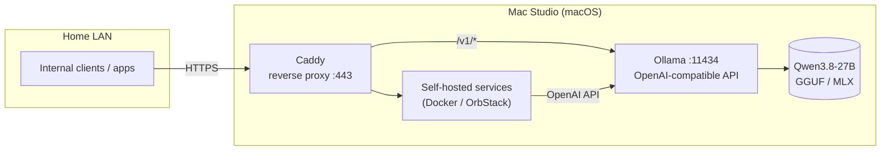

# Mac Studio AI Home Server

[](LICENSE)
[]()
[]()

> A silent, always-on homelab on Apple Silicon that hosts the whole house: every
> `.allen` page, the network services, and a local LLM over an OpenAI-compatible API.

**Status:** 🟢 Hardware bought — **Rocinante** (new Apple Silicon Mac) arrives soon.
DDR is folded in; scope is in [`docs/objectives.md`](docs/objectives.md) and the
migration kit is in [`docs/migration.md`](docs/migration.md).

**Rendered docs:** https://chris-l-allen.github.io/mac-studio-ai-homeserver/

---

## What this is

**Rocinante** is the one box that runs the whole house:

1. **Every `.allen` page & network service** — the DNS authority for the `allen`
   zone, a private CA + device enrollment, and a Caddy reverse proxy in front of
   `homenetwork.allen`, `poker.allen`, `hypometer.allen`, and `ddr.allen`.
2. **Local inference** — **Qwen3.8-27B** (Apache-2.0) behind an OpenAI-compatible
   `/v1/chat/completions` endpoint, used by the Gmail→Calendar daemon and any other
   sensitive job. No per-token bill, no data leaving the house.
3. **The DDR station** — the HomeDDR song/media library (and Project OutFox),
   folded in from the separate `home-ddr` project.

Design priorities, in order: **quiet, cheap to run 24/7, enough unified memory for a
27B model, and no ugly tower in the kids' homework space.**

The whole point is the *server* framing: the model is a resident background service
called over HTTP by other apps, not a chat window.

## Services on the box

| Host / unit | Service | Docs |
|---|---|---|
| `homenetwork.allen` | portal, DNS (`:53`), CA, enrollment | [network](docs/network.md) |
| `poker.allen` | Moonbeam Hold'em (`:8080`) | — |
| `hypometer.allen` | Leafs hypometer (`:8899`) | — |
| `ddr.allen` | DDR song/media library (`:8787`) | [DDR](docs/ddr.md) |
| `llm.allen` | Ollama / Qwen 27B (`:11434`) | [inference](docs/inference.md) |

**Documentation:** [Objectives](docs/objectives.md) ·
[Migration runbook](docs/migration.md) · [Network & `.allen`](docs/network.md) ·
[Inference](docs/inference.md) · [DDR](docs/ddr.md) ·
[all docs rendered](https://chris-l-allen.github.io/mac-studio-ai-homeserver/docs/)

**Moving it to Rocinante:** see [docs/migration.md](docs/migration.md) and
`scripts/migrate/`. The laptop is untouched until cutover and then becomes a client.

---

## TL;DR

| | |
|---|---|
| **Machine** | Mac Studio (Apple Silicon, unified memory) |
| **Constraint** | **48 GB RAM minimum** — optimize **form factor / CPU / GPU**; ignore storage & ethernet |
| **Best 48 GB value** | **New M5 Max · 40-core GPU · 48 GB · 512 GB — $4,399 CAD** — 614 GB/s, minimal storage |
| **Best overall value** | **New M5 Ultra · 96 GB · 1 TB — $7,799 CAD** — 1.2 TB/s, 70B-capable |
| **Cheapest 48 GB** | Refurb Mac mini M4 Pro · 48 GB — **$2,839** (but only 273 GB/s) |
| **Best refurb** | Refurb M3 Ultra · 96 GB / 2 TB — **$6,779** (819 GB/s) |
| **Dominated — skip** | MacBook Pro M5 Max 48 GB ($5,949) — same 614 GB/s as the $4,399 Studio |
| **Model** | **Qwen3.8-27B** — Apache-2.0, dense, multimodal, 262K context |
| **Serving** | Ollama (native) → OpenAI-compatible API on `:11434` |
| **Services** | Docker (OrbStack) behind Caddy |

**Constraint (2026-11-05):** 48 GB RAM is the floor; storage size and ethernet speed
are noise, so ignore their cost. That leaves **form factor, CPU, and GPU** as the real
variables. Because decode is memory-bandwidth-bound, form factor is essentially a
bandwidth choice: the Mac mini is cheapest but only **273 GB/s**; the Mac Studio M5 Max
gives **614 GB/s**; the M5 Ultra gives **1.2 TB/s**. Best value at 48 GB is the **M5 Max
40-core / 48 GB / 512 GB at $4,399** (140 GB/s per $1,000); best overall is the **M5
Ultra 96 GB at $7,799** (154). See [Inference per dollar](#inference-per-dollar).

---

## Goals

- [ ] Always-on, silent, low idle power (~10–20 W)
- [ ] Serve **Qwen3.8-27B** at Q6–Q8 with usable context
- [ ] Expose an **OpenAI-compatible API** to internal services
- [ ] Run self-hosted apps in Docker behind a reverse proxy
- [ ] Fit on a desk/shelf without looking like a gaming tower
- [ ] Stay under ~$8,000 CAD *(48 GB M5 Max $4,399; M5 Ultra $7,799)*

**Non-goals:** model training/fine-tuning, running frontier MoE models (400B+; needs
512 GB), gaming.

---

## Hardware decision

> **Historical.** This section is the hardware-selection analysis, kept for the
> record. The box is bought and named **Rocinante**; current scope lives in
> [`docs/objectives.md`](docs/objectives.md).

### Why a Mac Studio (and not a GPU tower)

For *serving* an LLM, the binding constraint is **whether the model + KV cache fit in
memory**, and secondarily **memory bandwidth** (which sets tokens/sec). On Apple
Silicon, the CPU, GPU, and Neural Engine share one high-bandwidth memory pool, so a
27B model loads whole — no 24 GB VRAM ceiling.

The GPU-tower route (used RTX 3090 → 24 GB) collapsed in 2026: an AI-driven memory
shortage sent discrete GPU prices through the roof (see
[price snapshot](#pricing-snapshot-re-verified-2026-11-05-cad)). A Mac Studio now delivers more
usable memory per dollar, idles at ~10–20 W, and is silent.

**Big caveat:** macOS is a less natural self-hosting platform than Linux. Docker via
OrbStack/Colima (or a small Linux VM) closes most of the gap; the LLM itself runs
natively because containers on macOS cannot use the Metal GPU.

### The real options at ≥48 GB (prices/bandwidth verified 2026-11-05)

| Form factor | Chip (CPU / GPU) | RAM | Bandwidth | Cheapest config | GB/s per $1,000 |
|---|---|---|---|---|---|
| Mac mini (refurb) | M4 Pro 12c / 16c | 48 GB | 273 GB/s | **$2,839** (512 GB) | 96 |
| Mac mini (refurb) | M4 Pro 14c / 20c | 48 GB | 273 GB/s | **$2,969** (512 GB) | 92 |
| MacBook Pro 16" (refurb) | M5 Max 18c / 40c | 48 GB | 614 GB/s | **$5,949** (2 TB) | 103 |
| Mac Studio (refurb) | M3 Ultra 28c / 60c | 96 GB | 819 GB/s | **$6,779** (2 TB) | 121 |
| **Mac Studio (new)** | **M5 Max 18c / 40c** | **48 GB** | **614 GB/s** | **$4,399** (512 GB) | **140** |
| **Mac Studio (new)** | **M5 Ultra 30c / 64c** | **96 GB** | **1,200 GB/s** | **$7,799** (1 TB) | **154** |

> Storage and ethernet are taken at the cheapest variant and **ignored** — you said not
> to spend on them. Each row is the cheapest listing for that chip/form factor.
>
> **Why the Mac mini is a false economy:** it is the cheapest 48 GB box, but M4 Pro
> bandwidth is only **273 GB/s** — about **45% of the M5 Max (614)** and **23% of the
> M5 Ultra (1.2 TB/s)**. For a resident LLM, bandwidth is the thing you are buying.
>
> **Why the MacBook Pro is dominated:** its 48 GB M5 Max 40-core is **$5,949** for the
> same **614 GB/s** as the $4,399 Mac Studio. You are paying for the screen/battery,
> not inference. Skip it for a server.
>
> **Bandwidth notes (Apple specs):** M4 Pro = 273 GB/s; M3 Ultra = 819 GB/s; M5 Max
> 32c = 460 GB/s, 40c = 614 GB/s; M5 Ultra = 1.2 TB/s. The old "~546 GB/s" M5 figure
> was wrong and is gone.

### Inference per dollar

Decode is memory-bandwidth-bound: each generated token reads the model weights once,
so tokens/sec scales with memory bandwidth for a fixed model and quantization. That
makes **GB/s per dollar** a fair, model-agnostic proxy for inference value.

| Option | Price | Bandwidth | GB/s per $1,000 | Est. 27B Q6 tok/s | Index |
|---|---|---|---|---|---|
| Refurb Mac mini M4 Pro 48 GB (16c GPU) | $2,839 | 273 GB/s | 96 | ~12 | 69 |
| Refurb Mac mini M4 Pro 48 GB (20c GPU) | $2,969 | 273 GB/s | 92 | ~12 | 66 |
| Refurb MacBook Pro M5 Max 48 GB | $5,949 | 614 GB/s | 103 | ~28 | 74 |
| Refurb M3 Ultra 96 GB | $6,779 | 819 GB/s | 121 | ~37 | 87 |
| **New M5 Max 48 GB (40c)** | **$4,399** | **614 GB/s** | **140** | **~28** | **100** |
| **New M5 Ultra 96 GB** | **$7,799** | **1,200 GB/s** | **154** | **~55** | **110** |

*Est. tok/s = bandwidth ÷ ~22 GB (27B Q6) — theoretical ceiling; ratios hold. Index is
normalized to the M5 Max 48 GB = 100 (the 36 GB is below the 48 GB floor).*

**Reading the table**

- **Best value at the 48 GB floor: new M5 Max 40-core / 48 GB / 512 GB — $4,399**
  (index 100). Meets the floor, gives 614 GB/s, smallest storage — exactly the brief
  (no storage/ethernet premium).
- **Best value overall: new M5 Ultra 96 GB — $7,799** (index 110). 1.2 TB/s and 70B
  capable. Costs $3,400 more, but it is the highest inference-per-dollar and the only
  sensible step up.
- **The Mac mini is the cheap 48 GB trap (index 66–69).** $2,839 sounds great until
  you see 273 GB/s: it is the *worst* inference-per-dollar here despite the low price.
- **The MacBook Pro is dominated** (index 74): same 614 GB/s as the $4,399 Mac Studio
  for $1,550 more. Form factor, not inference.
- **The refurb M3 Ultra (index 87)** is the best *refurb* Mac Studio, but it is worse
  value than both new Mac Studios and is stuck with a 2 TB SSD you don't want.

**Value frontier:** new M5 Max 48 GB ($4,399, best at the floor) → M5 Ultra 96 GB
($7,799, best overall). Everything else is slower per dollar (Mac mini), dominated
(MacBook Pro), or a worse-value refurb (M3 Ultra).

### Pricing snapshot (re-verified 2026-11-05, CAD)

Verified figures came from Apple's Canadian store in this session. **Prices move —
re-check before buying.**

| Configuration | Price (CAD) | Note |
|---|---|---|
| New M5 Max · 48 GB · 512 GB · 40c GPU | **$4,399** | 614 GB/s; 48 GB floor; **best 48 GB value** |
| New M5 Max · 64 GB · 512 GB · 40c GPU | **$4,999** | 614 GB/s; +16 GB capacity only |
| New M5 Max · 64 GB · 1 TB · 40c GPU | **$5,449** | 614 GB/s |
| New M5 Max · 128 GB · 1 TB · 40c GPU | **$7,849** | 614 GB/s; beaten by M5 Ultra at $7,799 |
| New M5 Ultra · 96 GB · 1 TB | **$7,799** | 1.2 TB/s; **best overall value** |
| Refurb Mac mini · M4 Pro · 48 GB · 512 GB | **$2,839** | 273 GB/s; cheapest ≥48 GB, but slow |
| Refurb MacBook Pro 16" · M5 Max 40c · 48 GB · 2 TB | **$5,949** | 614 GB/s; dominated by the $4,399 Studio |
| Refurb M3 Ultra · 96 GB / 2 TB (28c/60c) | **$6,779** | 819 GB/s; best refurb, worse value than new |
| Refurb M3 Ultra · 96 GB / 1 TB (32c/80c) | **$8,049** | 819 GB/s; outclassed by M5 Ultra |
| Refurb M3 Ultra · 96 GB / 4 TB (28c/60c) | **$8,049** | 819 GB/s; avoid the SSD premium |

**Do not overpay for storage or ethernet.** Take the smallest storage that clears the
48 GB floor; 512 GB holds the 27B quants (17–70 GB each) comfortably. Gigabit ethernet
is enough — 10GbE adds cost for no inference benefit here.

### CPU / GPU / memory: what actually matters

- **CPU:** effectively fixed on the M5 Max (18-core in both SKUs). It is *not* the
  LLM bottleneck — 18 cores is already overkill for a home server.
- **GPU:** 32- vs 40-core *does* matter on the M5 Max — the 40-core GPU has a wider
  memory bus (**614 vs 460 GB/s**), making it ~33% faster at inference. Core count
  itself is not the bottleneck; the bandwidth it buys is.
- **Memory *capacity*:** does **not** increase tokens/sec at a fixed GPU tier. More
  RAM buys *capacity*: bigger KV cache, higher quantization, or larger models. 64 GB
  does **not** make a 27B faster than 36 GB *on the same GPU*.
- **Memory *bandwidth*:** this is the lever for tokens/sec. It is set by the **chip
  and GPU-core tier**, not by how much RAM you buy: M5 Max 32-core GPU = 460 GB/s,
  M5 Max 40-core GPU = 614 GB/s, M3 Ultra = 819 GB/s, M5 Ultra = 1.2 TB/s. Want more
  speed on the M5 Max? You must take the 40-core GPU (which brings the 48 GB floor) —
  adding RAM to the 32-core GPU does nothing.

### Finance vs cash

Apple CA lists the M5 Max at `$158.23/mo × 24 = $3,797.52`, i.e. **~$298 interest
(~8% APR)** over the $3,499 price. Fine if you want to stay liquid; skip it if you
have cash. **Avoid the Apple Upgrade (Klarna) lease** for a box you intend to keep —
it's a rental, not a purchase.

**Education pricing** is post-secondary only (or school staff). Parents of K-12
students do **not** qualify; as of May 2026 Apple Canada requires **UNiDAYS**
verification and the old honor-system loophole is closed.

---

## Model choice

**Qwen3.8-27B** (`Qwen/Qwen3.8-27B`, Apache-2.0) — verified from the model card:

- 27B dense language model + vision encoder (~28B total), BF16 native
- Native **image + video** understanding
- **262K** native context, extensible to 1M
- **Thinking mode on by default** (disable per request with `enable_thinking: false`)
- Hybrid architecture: Gated DeltaNet (linear attention) + Gated Attention, with MTP
- GGUF / Ollama / MLX builds already exist
  (`unsloth/Qwen3.8-27B-GGUF`, `mlx-community/Qwen3.8-27B-4bit`)

### VRAM / memory footprint

| Quantization | Weight size | Fits on |
|---|---|---|
| BF16 | ~54 GB | 2× GPU, or 96 GB+ unified |
| Q8 | ~28 GB | 32 GB+ / 64 GB+ unified |
| **Q6** | **~21–22 GB** | **36 GB unified ✅ (recommended)** |
| Q4 | ~15–17 GB | 24 GB GPU |

### If you go to 96 GB (M3 Ultra or M5 Ultra)

You unlock the **70B dense tier**:
- **DeepSeek-R1-Distill-70B** — best local reasoning at this size
- **Llama 3.3 70B** — the safe, well-supported generalist
- Qwen's 2026 *dense* self-host ceiling is still the 27B; its flagship is a 2.4T MoE
  that **will not fit** in 96 GB (that needs a 512 GB config).

---

## Architecture



**Traffic flow**
1. A browser or internal app hits `https://something.internal`.
2. Caddy terminates TLS and reverse-proxies to the matching service.
3. Services that need AI call `http://host.docker.internal:11434/v1/...`.
4. Ollama runs the model resident and returns tokens.

---

## Software stack

| Layer | Choice | Why |
|---|---|---|
| LLM runtime | **Ollama** (native) | One-command models, OpenAI-compatible API, Metal GPU |
| Alt runtime | llama.cpp `server` / MLX-LM | More control / max Apple-Silicon speed |
| Containers | **OrbStack** | Fast, light Docker on macOS |
| Reverse proxy | **Caddy** | Automatic internal TLS, tiny config |
| Remote access | *TBD* — Tailscale likely | No port-forwarding |

> **Important:** run Ollama **natively**, not in Docker. Containers on macOS have no
> Metal/GPU passthrough, so a containerized Ollama would fall back to CPU. Docker is
> for the *other* services only.

---

## Quick start

```bash
# 1. Install runtime (native)
brew install --cask ollama        # or download from ollama.com

# 2. Pull the model (Q6_K ≈ 22 GB)
./scripts/pull-models.sh

# 3. Run the API in the foreground (test)
./scripts/serve-ollama.sh

# 4. In another shell — verify the OpenAI-compatible endpoint
curl -s http://localhost:11434/v1/chat/completions \
  -H 'Content-Type: application/json' \
  -d '{
        "model": "hf.co/unsloth/Qwen3.8-27B-GGUF:Q6_K",
        "messages": [{"role":"user","content":"Reply with the word: ready"}],
        "chat_template_kwargs": {"enable_thinking": false}
      }' | jq .

# 5. Install as a background service (macOS launchd)
cp launchd/com.local.ollama.plist ~/Library/LaunchAgents/
launchctl load ~/Library/LaunchAgents/com.local.ollama.plist

# 6. Bring up the web/services stack
docker compose up -d
```

### Persistence

The launchd plist keeps Ollama running with:
- `OLLAMA_KEEP_ALIVE=-1` — model stays resident (it's a server)
- `OLLAMA_CONTEXT_LENGTH=32768` — tune to your RAM headroom
- `OLLAMA_HOST=0.0.0.0:11434` — reachable from the LAN / containers

Adjust the binary path inside the plist if you installed Ollama via Homebrew
(`/opt/homebrew/bin/ollama`) instead of the app.

---

## API usage

Any OpenAI SDK works by pointing `base_url` at Ollama:

```python
from openai import OpenAI

client = OpenAI(base_url="http://localhost:11434/v1", api_key="not-needed")

resp = client.chat.completions.create(
    model="hf.co/unsloth/Qwen3.8-27B-GGUF:Q6_K",
    messages=[{"role": "user", "content": "Summarize this ticket..."}],
    extra_body={"chat_template_kwargs": {"enable_thinking": False}},
)
print(resp.choices[0].message.content)
```

**Multimodal:** send images as base64 in the OpenAI `image_url` content block. Video
input works but is heavy — treat it as out-of-scope for 24/7 serving.

---

## Repository layout

```
.
├── README.md
├── _config.yml                # GitHub Pages (Jekyll theme)
├── index.md                   # rendered docs page (includes README)
├── compose.yaml               # web/services stack (Ollama is NOT here)
├── .env.example
├── caddy/
│   └── Caddyfile              # internal reverse proxy + TLS
├── launchd/
│   ├── com.local.ollama.plist # keep Ollama running at login/boot
│   └── com.local.hardware-watch.plist  # poll refurb stock every 6h + commit
├── watchlist/
│   ├── targets.json           # what to watch + goal prices
│   ├── latest.json            # generated snapshot
│   └── README.md              # generated table
└── scripts/
    ├── pull-models.sh         # download Qwen3.8-27B
    ├── serve-ollama.sh        # foreground dev/test server
    └── poll-hardware.py       # refurb stock/price poller
```

---

## Procurement notes (Canada)

- **Apple Certified Refurbished** is the safe secondary channel: 1-year warranty,
  AppleCare+ eligible, like-new. It stocks the *previous* generation (M4 Max /
  M3 Ultra) — the M5 is too new.
- **Refurb inventory rotates**; watch `apple.com/ca/shop/refurbished/mac` and buy
  quickly when the right config appears.
- **Avoid marketplace/used** Macs: Apple Silicon RAM is soldered (unupgradeable), and
  used units carry Activation Lock / MDM (enterprise) risk.
- **Skip the 4 TB SSD** config; buy 512 GB–1 TB.

---

## Hardware watchlist (automated)

**Disarmed 2026-11-05** after the purchase. `watchlist/targets.json` has an empty
`targets` list; the two original refurb targets are kept under `_archived_targets`.
Move one back into `targets` to resume.

- `launchd/com.local.hardware-watch.plist` runs `scripts/poll-hardware.py --commit`
  every 6 hours (install it on Rocinante once the box is up).
- Run manually: `python3 scripts/poll-hardware.py` (add `--commit` to push).
- Re-arm by editing **`watchlist/targets.json`**.

> The poller reads each page's JSON-LD `Product`/`Offer` (authoritative per-SKU price
> and availability), not the JavaScript configurator. It's still best-effort: Apple
> can change markup or block automated requests, and refurb stock rotates fast.

---

## Open decisions / roadmap

- [x] **Hardware — bought:** **Rocinante** (new Apple Silicon Mac; confirm config at
  hand-off). See [`docs/objectives.md`](docs/objectives.md).
- [x] **Form factor:** Apple Silicon Mac (Rocinante).
- [x] **Storage/ethernet:** cheapest config; no storage/ethernet premium.
- [ ] **Reverse proxy:** Caddy (chosen) vs Traefik
- [ ] **Remote access:** Tailscale vs WireGuard
- [ ] **Backups:** Time Machine + offsite, or restic to an external disk
- [ ] **Monitoring:** Uptime Kuma (in compose) + macOS power/thermal checks
- [ ] **Model updates:** pin a quant; test upgrades before swapping

---

## Decision log

A record of how the plan got here (kept for future-me):

1. **Started** with "Mac Studio seems expensive; maybe kit-bash a GPU tower."
2. **Verified the model:** Qwen3.8-27B is real — 27B dense multimodal, Apache-2.0,
   262K context (corrected an earlier wrong assumption about Qwen's lineup).
3. **Checked GPU prices:** the 2026 AI-memory shortage sent RTX 4090 to ~$4,399,
   5090 to ~$7,488, and used 3090s to ~$1,100–1,400. The GPU tower lost its
   value advantage.
4. **Settled on Mac Studio** for unified memory, silence, and ~10–20 W idle.
5. **Sized the memory:** 36 GB runs 27B at Q6/Q8 — 64 GB buys capacity, not speed.
6. **Financing:** ~8% APR; paying cash.
7. **Education pricing:** not eligible (kids are K-12; policy is post-secondary /
   school staff, UNiDAYS-verified).
8. **Went to explore refurb:** M3 Ultra 96 GB (~819 GB/s) is the max-quality pick;
   the cheapest 96 GB config is the 2 TB (28c/60c) at **$6,779**, while the 1 TB
   (32c/80c) is $8,049 — actually outclassed by the M5 Ultra at $7,799.
9. **New plan under consideration:** "huge RAM, unified, last-gen" → refurb M3 Ultra
   96 GB to reach the 70B dense tier.
10. **Re-verified prices and bandwidth (2026-11-05).** Apple CA lists the M5 Max
    18c/32c at **460 GB/s**, the 18c/40c at **614 GB/s**, the M5 Ultra at **1.2 TB/s**,
    and the M5 Ultra 96 GB / 1 TB at **$7,799**; the refurb M3 Ultra 96 GB / 2 TB is
    still **$6,779** and in stock. Corrected the old "~546 GB/s *(est.)*" figure — the
    M5 Max was never 546 GB/s.
11. **Ran the value math.** GB/s per $1,000: M5 Ultra **154 (best)**, M5 Max 40c 140,
    M5 Max 32c 131, refurb M3 Ultra **121 (worst)**. The refurb is the cheapest 70B
    box, not the best value. Dropped it from contention.
12. **Reframed the decision (2026-11-05): 48 GB is the floor, storage/ethernet are
    noise.** Optimize form factor/CPU/GPU instead. Pulled every ≥48 GB refurb listing:
    Mac mini M4 Pro 48 GB from **$2,839** (273 GB/s), MacBook Pro M5 Max 48 GB
    **$5,949** (614 GB/s), Mac Studio M3 Ultra 96 GB **$6,779** (819 GB/s). The Mac mini
    is cheapest but indexes 66–69; the MacBook Pro is dominated; the M3 Ultra is the
    best refurb but worse value than new.
13. **Value result:** new **M5 Max 40-core 48 GB / 512 GB ($4,399, index 100)** is the
    best 48 GB value; new **M5 Ultra 96 GB ($7,799, index 110)** is the best overall.
    The Mac mini's 273 GB/s makes it the worst inference-per-dollar despite being the
    cheapest.
14. **Named the box Rocinante (2026-11-05).** The current Mac is the personal laptop;
    it and every other device become consumers of Rocinante's services.
15. **Collapsed HomeDDR into this repo (2026-11-05).** Code lives under `services/ddr/`,
    docs under `docs/ddr*.md`; the original README, HANDOFF, AGENTS, and LICENSE are
    preserved under `services/ddr/`.
16. **Folded the .allen network stack in (2026-11-05).** Portal/DNS/CA under
    `services/network/`, one Caddyfile for every `.allen` host, and a migration kit in
    `scripts/migrate/` + `docs/migration.md`.

---

## Evidence & sources

Labels used above: *(verified)* = read directly from a primary source during planning;
*(inferred)* = follows from the numbers but was not measured. Prices and bandwidth were
**re-verified 2026-11-05** and still change frequently.

- Qwen3.8-27B model card — <https://huggingface.co/Qwen/Qwen3.8-27B>
- Apple Canada — new Mac Studio: <https://www.apple.com/ca/shop/buy-mac/mac-studio>
- Apple Canada — Mac Studio tech specs (bandwidth): <https://www.apple.com/ca/mac-studio/specs/>
- Apple Canada — refurbished Mac: <https://www.apple.com/ca/shop/refurbished/mac>
- GPU street prices (Oct 2026) — Tom's Hardware price index:
  <https://www.tomshardware.com/pc-components/gpus/lowest-gpu-prices-tracking>
- Used RTX 3090 pricing — GPUDojo / Silicon Comps / bestvaluegpu (third-party trackers)

---

## License

MIT — see [LICENSE](LICENSE).
